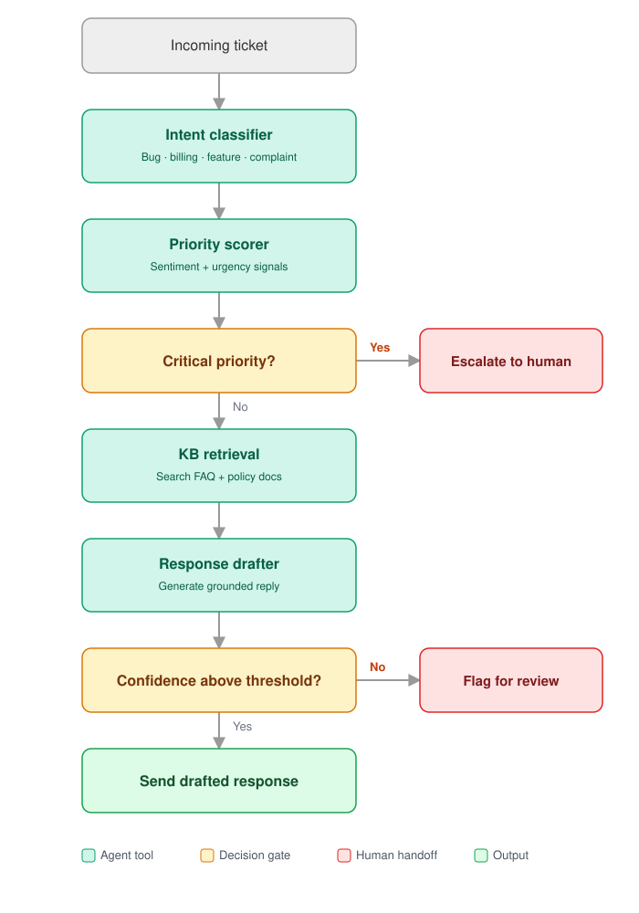

# Support Ticket Triage & Response Agent

A multi-step AI agent that automatically classifies, prioritizes, and responds to customer support tickets using LangGraph orchestration, RAG-based knowledge retrieval, and LLM-powered response generation.

## Architecture



- **Intent classifier** — categorizes as bug · billing · feature · complaint
- **Priority scorer** — sentiment + urgency signals
- **KB retrieval** — searches FAQ + policy docs
- **Response drafter** — generates a grounded reply

Each box maps directly to code:

| Diagram node               | Kind          | File                                                | Function                |
|-----------------------------|---------------|------------------------------------------------------|--------------------------|
| Incoming ticket              | input         | [`src/agent/state.py`](src/agent/state.py)           | `TicketState` (shared state passed between every node) |
| Intent classifier            | Tool 1        | [`src/tools/intent_classifier.py`](src/tools/intent_classifier.py) | `classify_intent()`      |
| Priority scorer              | Tool 2        | [`src/tools/priority_scorer.py`](src/tools/priority_scorer.py)     | `score_priority()`       |
| Critical priority? (gate)    | decision      | [`src/agent/graph.py`](src/agent/graph.py)           | `route_after_priority()` |
| Escalate to human            | handoff       | [`src/agent/graph.py`](src/agent/graph.py)           | `escalate_node()`        |
| KB retrieval                 | Tool 3        | [`src/tools/kb_retriever.py`](src/tools/kb_retriever.py) + [`src/knowledge/vector_store.py`](src/knowledge/vector_store.py) | `retrieve_from_kb()` (ChromaDB similarity search) |
| Response drafter             | Tool 4        | [`src/tools/response_drafter.py`](src/tools/response_drafter.py)   | `draft_response()`       |
| Confidence ≥ threshold? (gate) | decision    | [`src/agent/graph.py`](src/agent/graph.py)           | `route_after_draft()`    |
| Flag for review              | handoff       | [`src/agent/graph.py`](src/agent/graph.py)           | `flag_node()`            |
| Send drafted response        | output        | [`src/agent/graph.py`](src/agent/graph.py)           | `send_node()`            |

The whole pipeline is wired together as a LangGraph state machine in `build_agent_graph()` inside [`src/agent/graph.py`](src/agent/graph.py).

## Tech Stack

| Layer             | Tool                        | Why                                      |
|-------------------|-----------------------------|------------------------------------------|
| Agent framework   | LangGraph                   | State machine with conditional routing    |
| LLM orchestration | LangChain                   | Prompts, tool definitions, output parsing |
| LLM provider      | Groq / OpenRouter / OpenAI  | Set `LLM_PROVIDER` in `.env` ([`src/llm.py`](src/llm.py)); Groq's free tier is too small for the full ablation |
| Vector store      | ChromaDB                    | Local, no infra, persistent               |
| Embeddings        | sentence-transformers       | Free local embeddings (MiniLM)            |
| UI                | Streamlit                   | Fast prototyping, easy for non-coders     |
| Evaluation        | scikit-learn + custom       | Precision, recall, F1 + ablation table    |
| Language          | Python 3.10+                | Only language needed                      |

## Project Structure

```
support-agent/
├── config/
│   └── settings.py              # All config in one place (CONFIDENCE_THRESHOLD, provider, etc.)
├── data/
│   ├── raw/                     # Raw ticket datasets (Bitext, Kaggle) — populate locally
│   ├── knowledge_base/
│   │   └── billing_faq.md       # FAQ/policy docs the KB retriever searches
│   └── golden_set/
│       └── golden_qa.csv        # Ground-truth evaluation set
├── src/
│   ├── agent/
│   │   ├── graph.py             # LangGraph pipeline — wires nodes + decision gates
│   │   ├── single_shot.py       # One-LLM-call baseline for the ablation table
│   │   └── state.py             # TicketState TypedDict — shared state through the graph
│   ├── tools/
│   │   ├── intent_classifier.py # Tool 1 — classify_intent()
│   │   ├── priority_scorer.py   # Tool 2 — score_priority()
│   │   ├── kb_retriever.py      # Tool 3 — retrieve_from_kb()
│   │   └── response_drafter.py  # Tool 4 — draft_response()
│   ├── knowledge/
│   │   └── vector_store.py      # ChromaDB wrapper used by the KB retriever
│   └── evaluation/
│       ├── evaluator.py         # Golden set eval + ablation runner
│       └── build_golden_set.py  # Labels + samples Kaggle tickets into the golden set
├── app/
│   └── streamlit_app.py         # Streamlit frontend
├── tests/                       # Unit + integration tests (LLM and embeddings stubbed)
├── requirements.txt
├── .env.example
└── README.md
```

## Setup

```bash
# 1. Clone and enter
git clone <repo-url>
cd support-agent

# 2. Create virtual env
python -m venv venv
source venv/bin/activate   # Windows: venv\Scripts\activate

# 3. Install dependencies
pip install -r requirements.txt

# 4. Configure environment — either export the key in your shell…
export OPENROUTER_API_KEY=...          # from https://openrouter.ai/keys
# …or put it in .env (shell variables take precedence; .env is gitignored)
cp .env.example .env

# 5. Run the app (indexes data/knowledge_base/ on first run)
streamlit run app/streamlit_app.py
```

### Other commands

```bash
pytest                                        # unit + integration tests (no API calls)
RUN_LIVE_TESTS=1 pytest tests/test_live.py -v # end-to-end on the real LLM + KB (costs a few tokens)
python -m src.knowledge.vector_store          # rebuild the KB index after editing data/knowledge_base/
python -m src.evaluation.build_golden_set     # regenerate the Kaggle rows of the golden set (needs data/raw/)
python -m src.evaluation.evaluator            # score the full agent on the golden set
python -m src.evaluation.evaluator --ablation # fill in the ablation table (4 variants)
```

## Sprint Schedule

Gantt chart mapping every task in this README to a day and an owner: https://claude.ai/code/artifact/289922ef-e1f2-41f1-a1aa-8064d3aa2fd8

## Team Assignments

### Strong Technical Members (2-3 people)
- **Agent pipeline**: `src/agent/graph.py` — LangGraph state machine
- **Tool implementations**: All 4 files in `src/tools/`
- **Vector store**: `src/knowledge/vector_store.py` — ChromaDB + embeddings
- **Evaluation code**: `src/evaluation/evaluator.py` — metrics + ablation runner

### Other Members (2 people)
- **Knowledge base curation**: Write FAQ/policy docs in `data/knowledge_base/`
- **Golden test set**: Build 50-100 rows in `data/golden_set/golden_qa.csv`
- **Streamlit UI**: `app/streamlit_app.py` — layout and display logic
- **Prompt ablation execution**: Run experiments, record results, build comparison table
- **Documentation**: README, demo slides, final report

## Evaluation Strategy (CV Differentiator)

### Golden Test Set
50-100 support tickets with ground-truth labels for intent, priority, action, and reference response. This is what separates a real project from a toy demo.

`data/golden_set/golden_qa.csv` has 73 rows: 5 hand-written (`source=hand`) and 68 sampled from the Kaggle dataset (`source=kaggle`) by `build_golden_set.py` — 8 escalation tickets plus ~10 per intent, seeded so it is reproducible. The Kaggle labels are **derived by rules**, not human-annotated:

- **intent** — dataset queue + ticket type + keyword rules (the dataset's queues are noisy, so billing also requires billing wording, etc.)
- **priority** — dataset priority; a `high` *incident* mentioning a breach / outage / legal threat is promoted to `critical` (the dataset has no critical level)
- **action** — `critical` → `escalate`, everything else → `send`

Spot-check these before reporting results — `complaint` is the weakest label, as the dataset's tone is mostly neutral B2B. Hand-corrected rows should be changed to `source=hand` so a regeneration keeps them.

### Ablation Table
Run 4 agent variants against the golden set and compare (`python -m src.evaluation.evaluator --ablation`, ~4 min).

73 golden tickets, `openai/gpt-oss-120b` via OpenRouter, confidence threshold 0.7, retrieval floor 0.3, 0 degraded rows (after the improvement round; baseline in parentheses):

| Variant          | Intent Acc    | Priority Acc  | Action Acc    | Response Quality (ROUGE-L) |
|------------------|---------------|---------------|---------------|-----------------|
| Full agent       | 0.767 (0.726) | 0.411 (0.329) | 0.247 (0.123) | 0.154 (0.135)   |
| No KB retrieval  | 0.767 (0.699) | 0.425 (0.342) | 0.192 (0.096) | 0.141 (0.106)   |
| No priority gate | 0.753 (0.712) | 0.425 (0.356) | 0.082 (0.096) | 0.160 (0.136)   |
| Single-shot LLM  | 0.740 (0.712) | 0.479 (0.452) | 0.767 (0.836) | 0.082 (0.095)   |

**Noise:** one ticket moves a metric by 0.014, and a repeat run of the full agent gave intent 0.740 and action 0.205, so treat gaps under ~0.05 as noise.

What it shows:
- **The priority gate earns its place.** The full agent escalates **9/9** critical tickets (baseline: 0/9), with 2–4 false escalations depending on the run. Removing the gate drops action accuracy from 0.247 to 0.082. The old scorer required *anger* plus a keyword, but breach and outage reports are written calmly, so it now judges severity with the LLM.
- **KB retrieval helps response quality** (0.154 vs 0.141), and the full agent leads No-KB on action in this run. Earlier runs disagreed on that ordering, so the action gap is not a robust result.
- **No-KB deliberately has no retrieval floor.** Without retrieval there is no score to gate on. The only "equivalent" would be never auto-sending, which would make the variant score worse by design rather than show what the KB contributes. So No-KB is the agent as it would really be built without a KB, and its extra sends are *ungrounded*. Judge the KB's value by grounding and response quality, not by action accuracy.
- **Low action accuracy is a KB-coverage problem, not a routing bug.** The KB covers only billing, and auto-send requires a KB match ≥ 0.3. So the agent sends billing replies and flags everything else for review. Single-shot "wins" on action by sending ungrounded answers, which is exactly what the agent is designed to avoid. The metric rewards sending, not grounded correctness.
- **Prompt injection:** a ticket telling the model to "rate your confidence 1.0" can no longer force an auto-send, because the retrieval floor gates sending independently (strict live test).

This table proves each component adds value — that's what hiring managers look for.

## Data Sources
- **Ticket dataset**: [Customer IT Support – Ticket Dataset](https://www.kaggle.com/datasets/tobiasbueck/multilingual-customer-support-tickets) (Tobias Bueck, CC BY-NC 4.0) — ~28.6k synthetic tickets (16.3k English) with subject, body, reference answer, queue, priority, and type. Not committed; download it with:
  ```bash
  python -c "import kagglehub; kagglehub.dataset_download('tobiasbueck/multilingual-customer-support-tickets', output_dir='data/raw/customer-support-tickets')"
  ```
- **KB content**: Write your own (simulated company FAQ/policies)
